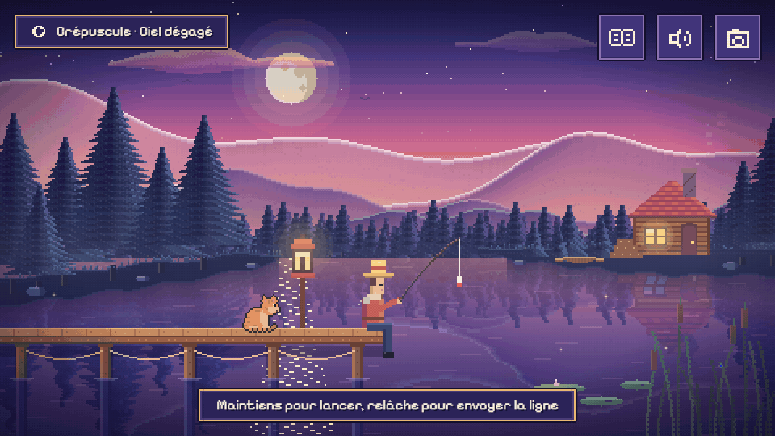
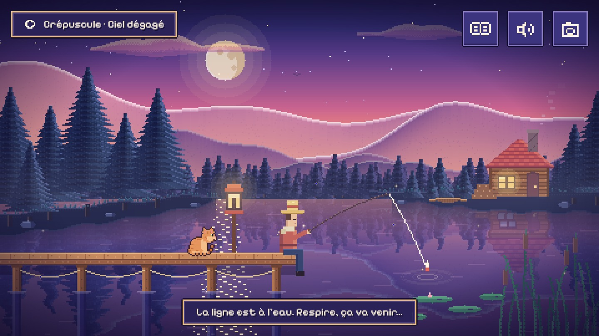
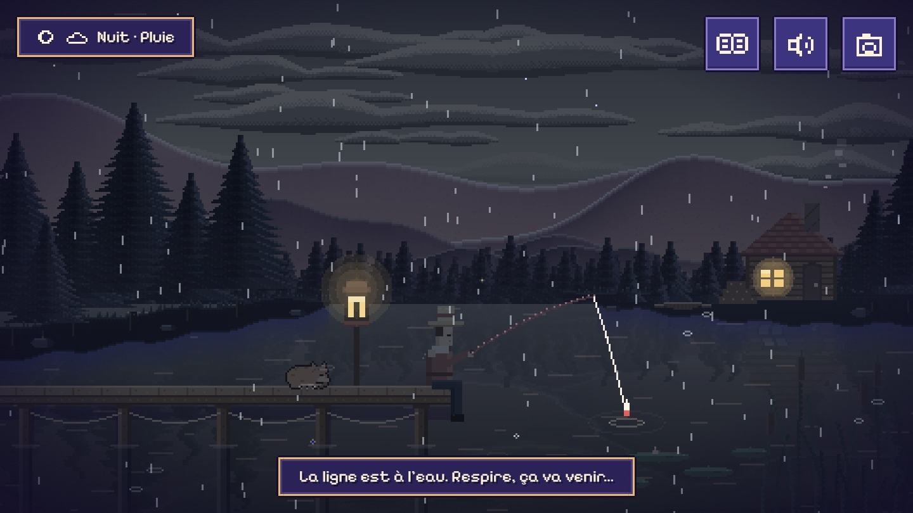
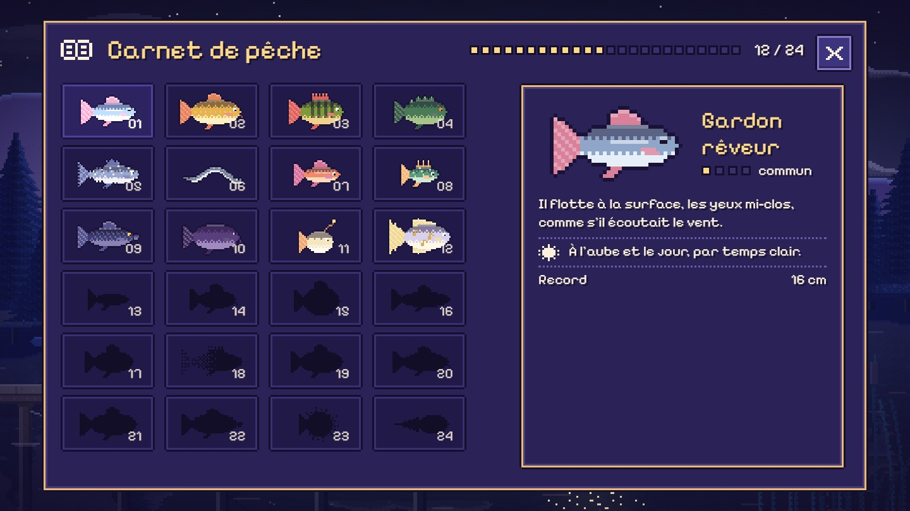

# Lullaby Lake

**A lake, a fishing rod, all the time in the world.** A small, cozy fishing game for the browser, in pixel art: you watch, you breathe, you fill your fishing journal.

[Version française](README.md)



*The GIF is a montage of two real recordings of the game (dusk, then a moment of night and rain), without sound.*

## What is it?

- **Zen fishing, no winning.** No score, no game over, nothing is ever lost. You cast the line, wait, reel in, then put the fish back or admire its card.
- **24 fish to collect**, drawn for the game. Each one has its own hours and weather: some mostly come out at night, or more often in the rain. The journal gives a hint to find them.
- **A living lake**: day, dusk, night and dawn blend slowly into each other (a full day lasts 8 minutes), with sun, moon, stars, clouds, rain and mist.
- **A lake with life**: a cat that stretches, yawns and curls up to sleep at night, birds passing now and then (heron, geese, owl), a frog, dragonflies, fish jumping far away, a bat at dusk, a rare shooting star under a clear sky. Everything is silent and discreet, and stays still with "reduced motion".
- **Sound almost entirely made by code** (Web Audio: water, wind, rain, crickets, birds, and two generated music styles: soft or lofi). A third style, "Real lofi tracks", plays **3 recorded tracks** by omfgdude, free of rights (CC0, see `THIRD-PARTY`); they are loaded only if you choose that style. The sound only starts after "Start"; you can play without sound.
- **No ticking clock.** One deliberate exception: when a fish bites, it gently swims away after 8 seconds and comes back later (the same fish, nothing is lost, no countdown on screen). The setting "Let the fish wait" removes that limit.
- **Your game is kept in your browser** (journal, settings), with no account and nothing sent anywhere.
- **Photo mode**: a 1920 x 1080 PNG image of the lake, without the interface.
- **Works offline** after the first load (service worker). The 3 recorded tracks are not part of that first load: a track works offline once it has been listened to.
- **French and English.**

## Screenshots

| Dusk | Night and rain | Fishing journal |
|---|---|---|
|  |  |  |

(The screenshots show the French interface; the game also speaks English.)

## Play

**Online**: not published yet. [to be completed after publication]

**Locally** (you need [Node.js](https://nodejs.org/) 22 or newer; tested with Node 22.14; no package to install, `npm install` is not needed):

```
node tools/serve.mjs
```

Then open the address printed in the terminal in your browser (usually `http://127.0.0.1:4183/`). A small server is needed because browsers refuse to load JavaScript modules from a file opened directly (`file://`). This server only listens on your own computer (`127.0.0.1`).

On the first screen: **Start** (with sound) or **Without sound**. (The game opens in your browser's language, French or English; the first screen has a switch.) Then **press and hold** the mouse button (or your finger, or Space) to cast, and **release** to send the line out. When a fish bites, **press once** to reel it in.

## Controls

| | Mouse / touch | Keyboard |
|---|---|---|
| Cast | press and hold on the scene, release | hold Space or Enter, release |
| Reel in (when a fish bites) | press on the scene | Space or Enter |
| Fishing journal | "book" button, top right | `C` |
| Settings (language, text size, volumes, ...) | "speaker" button | `R` |
| Photo mode | "camera" button | `P` |
| Mute / unmute | checkbox in the settings | `M` |
| Close a panel | the X button | `Esc` |

The keyboard shortcuts `C`, `R`, `P`, `M` can be turned off in the settings. On a phone the game is played **in landscape**: in portrait, a message asks you to rotate the device.

## Accessibility (what is really there)

- **Reduced motion**: a setting (the game also follows the system preference).
- **Text size**: three sizes (normal, large, very large).
- **Nothing is carried by colour or sound alone**: a bite is shown by text and a "!" mark; a fish's rarity is written out in words as well as in pips; changes of time of day and weather are written on screen.
- **Keyboard**: you can cast, reel in, browse the journal (arrow keys) and change the settings without a mouse; checked by scripts in Chrome, not by a person playing with a keyboard.
- **No time limit** is possible with "Let the fish wait".
- **Without sound**: the game is complete without sound, and sound only starts after your first gesture.

Screen readers have **not** been tried (see below).

## Technical notes

- JavaScript (ES modules), no build step: the site is made of files served as they are.
- [PixiJS](https://pixijs.com/) 8.22.0 for display, copied into `vendor/` (no CDN, no network access at start-up).
- The scenery, the angler, the water, the rain and the fish are **painted by code** at a resolution of 480 x 270 pixels, scaled up with crisp pixels. Fish, moods and texts live in data files (`src/data/`): adding a species does not touch the core of the game.
- The game core (`src/core/`) depends neither on the browser nor on the display, so it can be tested without a browser.
- Sound: Web Audio. The ambience, the effects and the "Soft" and "Lofi" music styles are synthesised. The "Real lofi tracks" style plays 3 recorded files (`assets/music/`, 6.5 MB, CC0: see `THIRD-PARTY`), loaded only on request and kept by the service worker after the first listen.
- Tests: `npm test` (Node's built-in test runner, no dependency; more than 250 tests: fish draw, saving, day/night, FR/EN texts, service worker, no network access...).
- After changing a site file, `npm run sw` updates the offline file list (the service-worker test fails otherwise).
- Download size on first load: about 381 KiB with all files compressed (measured by compressing the whole set on 2026-11-05; the 3 music tracks, 6.5 MB, are not included).

## What is verified, what is not

The game has been exercised by **automatic scripts in Chrome on a Windows PC** (click, keyboard, emulated touch, graphics context loss, offline, saving after the browser is closed...). Everything else is written as it is: "not verified".

| | Windows | Mac | iPhone | Android |
|---|---|---|---|---|
| Chrome | tested (version 156) | not verified | not verified | not verified |
| Edge | tested (version 156, with the same scripts as Chrome) | not verified | — | — |
| Firefox | not verified | not verified | — | not verified |
| Safari | — | not verified | not verified | — |

Also **not verified**:

- **phones**: no real phone has been tried, only Chrome's touch emulation. Sound on iPhone (silent switch, resuming after the background) is not verified;
- **smoothness**: measured on a single, very powerful PC. Nothing is measured on a phone or a modest computer;
- **screen readers** (NVDA, VoiceOver...): the game announces changes in a region meant for them, but no screen reader has been tried;
- **the English text**: it was written without review by a native English speaker;
- **"a stranger casts a first line in under 10 seconds without reading anything"**: not verified by a human. A script follows the shortest path (2 interactions, a few seconds), which does not prove that a visitor gets there without hesitating;
- **how it feels**: the pace (the complete journal is estimated at about 2 h 20 by a simulation, not by played sessions), the quality of the sound and the fish leaving after 8 seconds have not been judged by real players;
- real private browsing, the "Save as" dialog of the photo, locked screen rotation.

## Licences

- **Code**: [MIT](LICENSE).
- **Artwork** (the fish, the screenshots and the GIF of this repository, the photos exported by the game): [CC BY 4.0](LICENSE-ART). If you reuse them, credit: "Lullaby Lake — artwork (dessins) © MalikChopa, CC BY 4.0, https://creativecommons.org/licenses/by/4.0/".
- **Third-party items** (PixiJS, the Pixelify Sans font, ...): see [THIRD-PARTY](THIRD-PARTY).

## Credits

A game by MalikChopa. Font [Pixelify Sans](https://github.com/eifetx/Pixelify-Sans) (SIL OFL 1.1). Display: [PixiJS](https://pixijs.com/) (MIT). The game was designed and programmed with the help of Claude (Anthropic), an artificial intelligence assistant; the art direction and the decisions are the author's.
