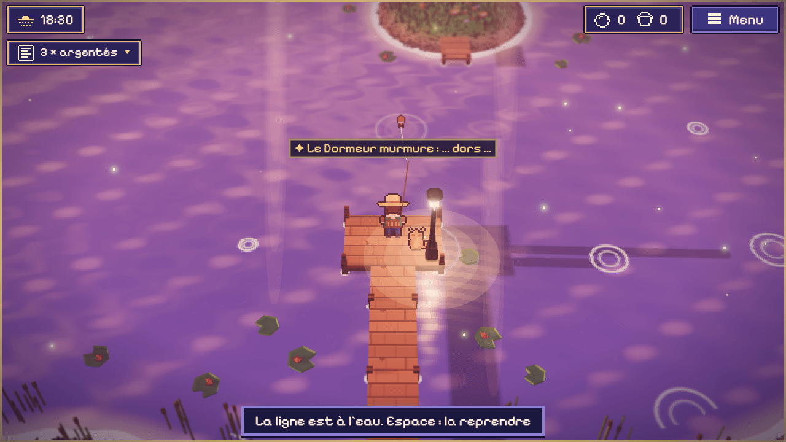
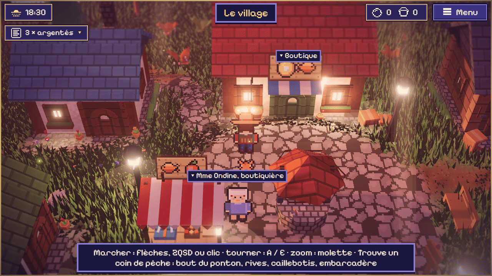
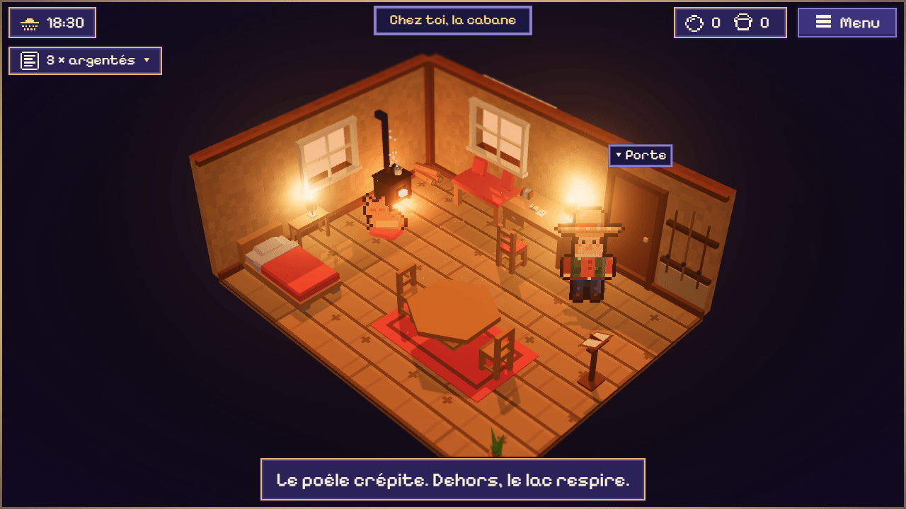

# Lullaby Lake

**Un lac qui rêve, une cabane, tout le temps du monde.** Un jeu de pêche zen dans le navigateur, en « HD-2D » : des personnages en pixel art qui marchent dans un petit monde en 3D, avec ses lumières, ses ombres, son herbe et son eau.

### ▶ [Jouer à Lullaby Lake](https://malikchopa.github.io/lullaby-lake/)

*Dans le navigateur, sans installation, sans compte, sans pub, sans achat. Sur téléphone, en paysage.*  ·  [English version](README.en.md)



| | |
|---|---|
|  |  |

## L'histoire : *La Berceuse du lac*

Tu hérites de la cabane de ta grand-mère, au bord d'un lac. Elle y chantait chaque soir. On dit qu'un esprit dort au fond de l'eau et que les poissons sont ses rêves. En pêchant, en parlant aux gens du village et en lisant les lettres laissées dans la cabane, tu retrouves peu à peu **les 8 couplets de la berceuse** ; chacun rend le lac un peu plus vivant. La fin est douce. Rien n'y fait peur.

## C'est quoi ?

- **Pêche zen, sans défaite.** On progresse (matériel, coins du lac, histoire) ; on ne perd jamais rien. Pas de score, pas de chrono qui presse.
- **Marcher dans le monde** : la cabane et son ponton, le village (la Boutique, l'Atelier, quatre maisons), la roselière, la forêt de pins, puis la barque vers les eaux profondes et un îlot.
- **Entrer dans les maisons** : chaque bâtiment a sa petite pièce, avec ses habitants.
- **24 poissons** à collectionner, et **8 poissons-rêves** liés à l'histoire. Chacun a ses heures, sa météo, son coin ; le carnet donne des indices.
- **Un peu de défi, jamais de punition** : vendre ses poissons en double (facultatif), acheter un meilleur matériel à la Boutique, des commandes sans date limite, une courte lutte quand le poisson mord (si on la rate, le poisson repart, rien n'est perdu ; une option « lutte automatique » existe). Le matériel s'use un peu et se répare à l'Atelier ; il ne casse jamais pour de bon.
- **Un lac vivant** : jour, crépuscule, nuit, aube ; soleil, nuages, pluie, brume ; le chat de la cabane.
- **Musique** : par défaut 3 morceaux lofi d'omfgdude, libres de droits (CC0) ; ou une musique « Douce » fabriquée par le code. On peut tout jouer **sans le son**.
- **Hors ligne** : après une première visite, le jeu se lance sans réseau.
- **Ta partie reste dans ton navigateur**, sans compte ; rien n'est envoyé nulle part.
- **Mode photo** : une image PNG de la vue, sans l'interface.
- **Français et anglais.**

## Commandes

| | Clavier | Souris | Tactile |
|---|---|---|---|
| Marcher | flèches, ou Z Q S D (AZERTY) / W A S D (QWERTY) | cliquer un endroit | pouce sur la moitié gauche (petit joystick), ou toucher un endroit |
| Lancer la ligne | maintenir Espace ou Entrée, relâcher | bouton « Pêcher » | bouton « Pêcher » |
| Remonter quand ça mord | Espace ou Entrée | bouton « Pêcher » | bouton « Pêcher » |
| Parler, entrer, utiliser | Entrée près de la personne ou de la porte | bouton d'action | bouton d'action, ou toucher la porte |
| Tourner la vue d'un quart de tour | A / E (AZERTY), Q / E (QWERTY) | — | boutons ⟲ ⟳ |
| Zoomer | — | molette | deux doigts |
| Carnet · commandes · sac · photo · réglages | C · O · B · P · R | menu en haut à droite | menu en haut à droite |
| Couper le son | M | réglages | réglages |
| Fermer un panneau | Échap | bouton ✕ | bouton ✕ |

Les touches de marche et de vue sont prises à leur place sur le clavier, quelle que soit sa disposition. Les raccourcis à une lettre peuvent être désactivés dans les réglages.

## Accessibilité (ce qui est réellement là)

- **Rien ne presse** : aucun compte à rebours ; « Laisser le poisson attendre » et « lutte automatique » dans les réglages.
- **Mouvement réduit** (suit aussi le réglage du système), **trois tailles de texte**, **interface discrète**.
- **Rien n'est porté par la couleur ou le son seuls** : la touche, la lutte, l'usure s'écrivent aussi en mots et en formes.
- **Tout le jeu au clavier**, aussi à la souris et au tactile ; les messages importants sont placés dans des zones lues par les lecteurs d'écran.

## Jouer en local

Le dépôt contient le jeu tel quel, sans étape de construction. Lance n'importe quel serveur de fichiers statiques à la racine du dépôt, par exemple :

```
python -m http.server 8000
```

puis ouvre `http://localhost:8000/refonte/`. Il faut un navigateur qui sait afficher la 3D (WebGL 2) ; sinon, le jeu le dit.

## Ce qui n'est pas vérifié

Le jeu a été essayé par des scripts automatiques dans Chrome sur un seul PC Windows (clavier, souris, tactile émulé, hors ligne, sauvegarde). Tout le reste est **non vérifié** :

- **les vrais téléphones** : seulement l'émulation de Chrome sur un PC de bureau ;
- **Safari et Firefox** (et donc Mac, iPhone) : non essayés ;
- **les lecteurs d'écran** (NVDA, VoiceOver…) : non essayés ;
- **la musique et la fin de l'histoire** : jamais écoutées ni jouées d'un bout à l'autre par une personne ;
- **les durées et la fluidité** : mesurées sur un seul PC rapide, elles ne disent rien d'un téléphone moyen.

## Crédits

Un jeu de MalikChopa.

- 3D : [three.js](https://threejs.org/) (MIT), copié dans `vendor/` (aucun CDN).
- Modèles 3D du décor : [Kenney](https://www.kenney.nl/) (CC0), allégés et recolorés ; l'eau, l'herbe, la lumière, les personnages et les poissons sont faits par le code.
- Musique : omfgdude (CC0, OpenGameArt).
- Police : [Pixelify Sans](https://github.com/eifetx/Pixelify-Sans) (SIL OFL 1.1).

Le jeu a été conçu et programmé avec l'aide de Claude (Anthropic), un assistant d'intelligence artificielle ; la direction artistique et les décisions sont celles de l'auteur.

## Licences

- **Code** : [MIT](LICENSE).
- **Dessins et sons** créés pour le jeu : [CC BY 4.0](LICENSE-ART), © MalikChopa. Si tu les réutilises, cite : « Lullaby Lake — © MalikChopa, CC BY 4.0, https://creativecommons.org/licenses/by/4.0/ ».
- **Éléments tiers** (three.js, police, modèles 3D, musiques) : voir [THIRD-PARTY](THIRD-PARTY) et [les crédits des modèles](refonte/assets/models/CREDITS.txt).
